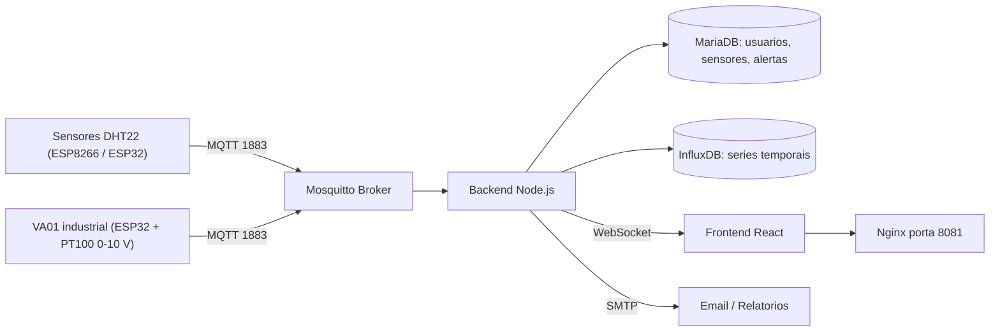

# TH-GUARD — Plataforma de Monitoramento

Monitoramento de temperatura e umidade de ambientes (ESP8266/ESP32 + DHT22) e de temperatura
de máquinas (VA01: ESP32 + PT100 via transmissor 0–10 V), com backend Node.js, painel React
e banco MariaDB + InfluxDB.

## Arquitetura



## Stack

- **Firmware:** ESP8266 (NodeMCU 1.0) ou ESP32 + DHT22; ESP32 + PT100/TxIsoRail (VA01)
- **Broker:** Eclipse Mosquitto 2 (MQTT)
- **Backend:** Node.js + Express + WebSocket
- **Frontend:** React + Vite
- **Banco de dados:** MariaDB 11 + InfluxDB 2
- **Proxy:** Nginx
- **Containerização:** Docker + Docker Compose

## Funcionalidades

- Registro automático de sensores por endereço MAC
- Dashboard em tempo real via WebSocket
- Gráficos históricos (1h, 6h, 24h, 7d; 30d nos industriais)
- Alertas por email (temperatura alta, umidade alta, sensor offline; falha upscale nos industriais)
- Relatórios diário/semanal/mensal com CSV anexo
- Controle de acesso por roles (admin, editor, viewer) e por grupo (tag) de sensores
- Sensores industriais (VA01, PT100 0–10 V) em seção própria do painel, com calibração
  editável (faixa / temperatura de relação, offsets, limiares de falha) e área morta para o
  indicador Therma desligado — ver [docs/INDUSTRIAL.md](docs/INDUSTRIAL.md)
- Autenticação MQTT por usuário/senha com controle de ACL por tópico
- Interface responsiva (desktop e mobile)

## Pré-requisitos

- Docker e Docker Compose
- Arduino IDE 2.x ou `arduino-cli`, com suporte ESP8266 e/ou ESP32
- Bibliotecas Arduino:
  - sensores DHT22: DHT sensor library, PubSubClient, Adafruit GFX, Adafruit SSD1306, NTPClient
  - VA01 industrial: PubSubClient, ArduinoJson (v7)

## Instalação

### 1 — Clone o repositório

```bash
git clone https://github.com/SeulRKSantos/Sensor-de-Temperatura-inteligente.git
cd Sensor-de-Temperatura-inteligente/thguard
```

### 2 — Configure as variáveis de ambiente

```bash
cp .env.example .env
# Edite o .env com suas credenciais
nano .env
```

Variáveis que costumam dar problema:

- `ALLOWED_ORIGINS` deve conter **todo** endereço pelo qual o painel será acessado, separados
  por vírgula e sem espaços (ex: `http://localhost:8081,http://IP_DO_SERVIDOR:8081`). Se a origem não estiver
  na lista, o login retorna **erro 500**.
- `ADMIN_PASSWORD` é a senha do usuário `admin@thguard.local`, criado só quando o banco
  ainda não tem nenhum usuário.
- `MQTT_USER` / `MQTT_PASSWORD` são as credenciais do **backend** no broker (`thguard-backend`),
  as mesmas do passo 3.

### 3 — Configure o Mosquitto

O broker exige usuário e senha. O `acl.conf` já está no repositório; falta criar o `passwd`
com o usuário dos sensores (`thguard`) e o do backend (`thguard-backend`):

```bash
# Crie o arquivo de senhas do broker
docker run --rm -v $(pwd)/mosquitto/config:/mosquitto/config \
  --user root eclipse-mosquitto:2 \
  mosquitto_passwd -c -b /mosquitto/config/passwd thguard SUA_SENHA

docker run --rm -v $(pwd)/mosquitto/config:/mosquitto/config \
  --user root eclipse-mosquitto:2 \
  mosquitto_passwd -b /mosquitto/config/passwd thguard-backend SUA_SENHA_BACKEND
```

### 4 — Suba os containers

```bash
docker compose up -d
```

### 5 — Acesse o painel

Abra `http://localhost:8081` e entre com `admin@thguard.local` e a senha definida em `ADMIN_PASSWORD`.

> ⚠️ Troque a senha após o primeiro acesso em **Usuários**.

Ao recriar só o `backend` ou o `frontend` (`docker compose up -d --build backend frontend`),
reinicie também o Nginx — ele guarda os IPs antigos dos containers e passa a responder **502**:

```bash
docker restart thguard-nginx
```

## Firmware

Sketches disponíveis:

| Pasta | Placa | Uso |
|---|---|---|
| `firmware/thguard_v4_mac/` | ESP8266 (NodeMCU) | Firmware universal — registro por MAC |
| `firmware/thguard_v4_local/` | ESP8266 (NodeMCU) | Versão simplificada |
| `firmware/thguard_esp32/` | ESP32 DevKit | Port do v4 — mesmo protocolo MQTT |
| `firmware/va01_industrial/` | ESP32 DevKit | Sensor industrial VA01 (PT100 → TxIsoRail 0–10 V → GPIO34) |

Todos usam o mesmo protocolo: o sensor publica seu MAC em `thguard/register` e o
servidor responde em `thguard/<MAC>/config` com o `sensor_id` atribuído.
Detalhes do VA01 em [`firmware/va01_industrial/README.md`](firmware/va01_industrial/README.md).

**Pinagem ESP32:** DHT22 `GPIO4` · OLED `GPIO21/22` (I2C) · LEDs `GPIO25/26` · Botão reset `GPIO27`.
**Pinagem ESP8266:** DHT22 `GPIO2` · OLED `GPIO5/4` · LEDs `GPIO14/13` · Botão reset `GPIO0`.
**Pinagem VA01:** módulo 0–25 V `S` → `GPIO34` · `−` → `GND` · reset de fábrica: segurar `BOOT` 6 s.

O VA01 se registra com `"kind":"industrial"` e recebe IDs `ind-001`, `ind-002`...
Ele envia a tensão no pino; a conversão para °C é feita no servidor.

### Configuração

Cada sketch precisa de um arquivo secrets.h com as credenciais do broker MQTT.
Esse arquivo não é versionado (gitignored). Antes de compilar, copie o exemplo:

```bash
cd firmware/thguard_v4_mac
cp secrets.h.example secrets.h
```

Edite secrets.h com as credenciais do seu broker:

```cpp
#pragma once
#define MQTT_USER "thguard"
#define MQTT_PASS "TROQUE_AQUI"
```

### Upload (sensores DHT22)

1. Abra `firmware/thguard_v4_mac/thguard_v4_mac.ino` no Arduino IDE
2. Selecione: `Tools → Board → NodeMCU 1.0 (ESP-12E Module)`
   (ESP32: `ESP32 Dev Module` com `firmware/thguard_esp32/`)
3. Selecione: `Tools → Flash Size → 4MB (FS:2MB OTA:-1019KB)` (só ESP8266)
4. Grave o firmware: `Ctrl+U`
5. Sem Wi-Fi configurado, o sensor abre a rede `TH-GUARD-Setup`: conecte nela e abra
   `http://192.168.4.1` para informar o Wi-Fi e o IP do servidor. Depois de conectado,
   a mesma página fica em `http://IP_DO_SENSOR`.

> A senha da rede `TH-GUARD-Setup` está fixa no código (público). Se o sensor fica em local
> de acesso livre, troque-a no `.ino` antes de gravar.

## Estrutura do projeto

```text
thguard/
├── backend/              ← API Node.js + serviços
│   └── src/
│       ├── models/       ← MariaDB (db.js, migrate.js)
│       ├── routes/       ← auth, sensors, alerts, users, commands
│       └── services/     ← mqtt, influx, email, alertManager, scheduler, websocket, industrial
│   └── test/             ← testes (npm test, rodam no CI)
├── frontend/             ← React + Vite
│   └── src/
│       ├── pages/        ← Dashboard, Sensores, Industrial, Alertas, Relatórios, Usuários
│       ├── lib/          ← conversão do sensor industrial (pré-visualização)
│       └── components/   ← Layout, navegação
├── docs/                 ← Documentação (sensores industriais)
├── firmware/             ← Firmware ESP8266 / ESP32 / VA01
├── mariadb/              ← Schema SQL inicial
├── mosquitto/config/     ← Configuração do broker MQTT
├── nginx/                ← Configuração do proxy reverso
├── .env.example          ← Variáveis de ambiente necessárias
└── docker-compose.yml    ← Stack completa
```

## Licença

MIT
